# fMRI QC Decision Tree

> **Purpose:** A step-by-step reference guide for quality control of fMRI data using **MRIQC** and **fMRIPrep** visual reports. Use this document alongside `fMRI_QC_Scoresheet.xlsx` — open the report in one window, record PASS / FLAG / EXCLUDE for each criterion in the spreadsheet.
>
> **Primary references for criterion codes A–X:**
> - **[Provins2023]** Provins C et al. (2023). Quality control in functional MRI studies with MRIQC and fMRIPrep. *Front. Neuroimaging* 1:1073734. doi: [10.3389/fnimg.2022.1073734](https://doi.org/10.3389/fnimg.2022.1073734)
> - **[Lepping2023]** Lepping RJ et al. (2023). Quality control in resting-state fMRI: the benefits of visual inspection. *Front. Neurosci.* 17:1076824. doi: [10.3389/fnins.2023.1076824](https://doi.org/10.3389/fnins.2023.1076824)
> - **[Teves2023]** Teves JB et al. (2023). The art and science of using quality control to understand and improve fMRI data. *Front. Neurosci.* 17:1100544. doi: [10.3389/fnins.2023.1100544](https://doi.org/10.3389/fnins.2023.1100544)
> - **[Power2012]** Power JD et al. (2012). Spurious but systematic correlations in functional connectivity MRI networks arise from subject motion. *NeuroImage* 59:2142–2154.
> - **[Ciric2017]** Ciric R et al. (2017). Benchmarking of participant-level confound regression strategies. *NeuroImage* 154:174–187.
> - **[Birn2009]** Birn RM et al. (2009). The effect of respiration variations on independent components and resting-state functional connectivity. *NeuroImage* 47:1486–1498.

---

## How to Use This Document

1. Open the MRIQC or fMRIPrep HTML report for the subject.
2. Work through **Stage 1 → Stage 2 → Stage 3** in order.
3. For each check, assign one outcome and record it in `fMRI_QC_Scoresheet.xlsx`:

| Outcome | Meaning |
|---------|---------|
| **PASS** | No issue found |
| **FLAG** | Minor concern — document in the Notes column |
| **EXCLUDE** | Hard criterion met — stop QC, mark Final Decision as EXCLUDE |

> **Important:** A single **EXCLUDE** terminates the QC process. The participant is removed from further analysis regardless of all other checks. [Provins2023]

---

## Hard Exclusion Criteria — Quick Reference

Any of the following = **immediate exclusion**. Criterion codes follow [Provins2023] Tables 1–3.

| Code | Stage | Description |
|------|-------|-------------|
| **A** | MRIQC BOLD | Background artifact spills onto the brain |
| **BA** | MRIQC BOLD | Severe BOLD signal drop-out in cortical regions |
| **BB** | MRIQC BOLD | Severe brain distortions from SDC |
| **C** | MRIQC BOLD | Aliasing ghost at same intensity as brain interior |
| **D** | MRIQC BOLD | FOV wrap-around overlapping the cortex |
| **EC** | MRIQC BOLD | Coil failure in carpet plot (abrupt global change, no FD peak) |
| **ED** | MRIQC BOLD | Drift of unknown source (sustained polarized structure in carpet plot) |
| **I** | MRIQC BOLD | Data formatting issues (flipped axes, wrong orientation) |
| **M** | MRIQC T1w | FOV wrap-around overlapping the brain |
| **N** | MRIQC T1w | Data formatting issues |
| **R** | fMRIPrep | Failure in normalization to MNI space |
| **S** | fMRIPrep | Inaccurate brain mask — major cortical regions missing or large holes |
| **W** | fMRIPrep | Co-registration failure (EPI–T1w misalignment) |

---

## Decision Tree Flowchart

```mermaid
flowchart TD
    START([Start QC]) --> S1

    subgraph S1 [STAGE 1 — MRIQC BOLD Report]
        A{A: Background\nArtifacts?} -->|None or faint,\noutside brain| B
        A -->|Spills onto brain| EXCL_A[❌ EXCLUDE — A]

        B{B: Susceptibility\nDistortion?} -->|None| C
        B -->|Mild — note, add field maps| C
        B -->|Severe signal dropout| EXCL_BA[❌ EXCLUDE — BA]

        C{C: Aliasing\nGhost?} -->|None or faint| D
        C -->|Same intensity as brain| EXCL_C[❌ EXCLUDE — C]

        D{D: FOV\nWrap-around?} -->|None or not touching brain| E
        D -->|Overlaps cortex| EXCL_D[❌ EXCLUDE — D]

        E{E: Carpet Plot\nCrown Region?} -->|Clean| F
        E -->|Motion peaks EA or\nRespiration EB — flag| F
        E -->|Coil failure EC or\nDrift ED| EXCL_E[❌ EXCLUDE — EC/ED]

        F{H: Vertical Strikes\nin SD Map?} -->|None or localised| G
        F -->|Whole sagittal-plane\nstrikes| FLAG_H[⚠️ FLAG — H]

        G{F: ICA Spin-\nHistory Stripes?} -->|No stripes| S1_DONE[Stage 1 Complete]
        G -->|Whole-brain stripes| FLAG_F[⚠️ FLAG — F]
        FLAG_H --> S1_DONE
        FLAG_F --> S1_DONE
    end

    S1_DONE --> S2

    subgraph S2 [STAGE 2 — MRIQC T1w Report]
        P{P: Intensity\nNon-uniformity?} -->|Uniform or mild| O
        P -->|Extreme non-uniformity| FLAG_P[⚠️ FLAG — P]

        O{O: Motion / Gibbs\nRinging?} -->|None or mild| L
        O -->|Severe ringing throughout| FLAG_O[⚠️ FLAG — O]

        L{L: Aliasing\nGhost T1w?} -->|None or faint| M
        L -->|Significant| FLAG_L[⚠️ FLAG — L]

        M{M: FOV Wrap-around\nT1w?} -->|None or not touching brain| Q
        M -->|Overlaps brain| EXCL_M[❌ EXCLUDE — M]

        Q{Q: Eye\nSpillover?} -->|None or minimal| S2_DONE[Stage 2 Complete]
        Q -->|Significant — frontal lobe overlap| FLAG_Q[⚠️ FLAG — Q]

        FLAG_P --> O
        FLAG_O --> L
        FLAG_L --> M
        FLAG_Q --> S2_DONE
    end

    S2_DONE --> S3

    subgraph S3 [STAGE 3 — fMRIPrep Report]
        S{S: Brain\nMask?} -->|Accurate| R
        S -->|Major holes or inclusions| EXCL_S[❌ EXCLUDE — S]

        R{R: MNI\nNormalization?} -->|Good alignment| W
        R -->|Failure| EXCL_R[❌ EXCLUDE — R]

        W{W: Coregistration\nEPI–T1w?} -->|Good| T
        W -->|Poor alignment| EXCL_W[❌ EXCLUDE — W]

        T{T: Residual\nSDC?} -->|None or minor| U
        T -->|Severe in frontal regions| FLAG_T[⚠️ FLAG — T]

        U{U: Brain Tissue\nSegmentation?} -->|Clean or minor PVE| X
        U -->|Scattered voxel misclassification| FLAG_U[⚠️ FLAG — U]

        X{X: CompCor\nRegions?} -->|WM/CSF only| S3_DONE[Stage 3 Complete]
        X -->|Overlaps neural sources| FLAG_X[⚠️ FLAG — X]

        FLAG_T --> U
        FLAG_U --> X
        FLAG_X --> S3_DONE
    end

    S3_DONE --> DONE([Record in Scoresheet])
```

---

## Stage 1 — MRIQC BOLD Report

> Sample report: [MRIQC BOLD example](https://mriqc.readthedocs.io/en/latest/reports/bold.html#visual-reports)

---

### Check A — Artifactual Structures in Background

**Where to look:** BOLD average panel, background noise panel, standard deviation (SD) map. The SD map is the most sensitive — structures invisible in the average often appear as high-variance regions in the SD map.

**What it indicates:** No BOLD signal originates from air surrounding the head, so any visible structure in the background comes from a non-neural source — physical objects inside the scanner bore (head cushions, headphones, bite bars) that resonate with the RF pulse, or physiological motion artefacts. These sources produce a time-varying signal that, when overlapping brain tissue, introduces spurious temporal variance mimicking neural activity. This creates false connectivity between brain regions and the artefact zone — particularly damaging for resting-state ICA and seed-based connectivity analyses. [Provins2023]

Types observed in [Provins2023] (Data Sheet 1, Fig. S1): cushion-like structure, headphones, heavy local perturbation, and a strike pattern.

> **How to check:** Increase screen brightness — low-contrast artefacts are easier to see on a brighter screen. Check both the average and SD map panels.

| Finding | Outcome |
|---------|---------|
| Clean background or negligible speckling | **PASS** |
| Faint structures, entirely confined to background | **FLAG** |
| Structures spilling onto brain tissue | **EXCLUDE (Criterion A)** |

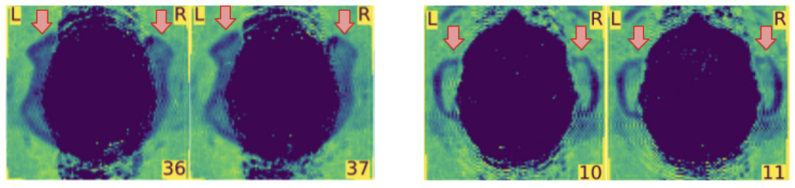
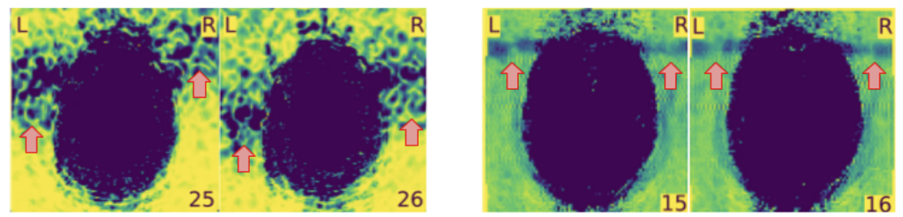

**(Fig. 1)** Perturbations spilling onto the brain (red arrows) → Criterion A, exclude. [Provins2023]

---

### Check B — Susceptibility Distortion (SDC)

**Where to look:** BOLD average panel (axial slices, especially inferior brain). Look for dark regions (signal dropout, criterion BA) or brain regions that appear stretched or compressed (brain distortions, criterion BB).

**What it indicates — Signal dropout (BA):** The B₀ magnetic field is perturbed at air–tissue interfaces (sinuses, ear cavities). Spins in these regions dephase rapidly, leading to complete T2* signal loss before the echo can be read. The result is that BOLD signal in the anterior OFC, vmPFC, and regions near the mastoid air cells is **never recorded** — those voxels contain only noise. No preprocessing step can recover signal that was never acquired. Distortion also displaces the apparent position of nearby brain regions along the phase-encoding direction, making spatial labelling inaccurate. [Provins2023]

**What it indicates — Brain distortions (BB):** The spatial displacement creates the appearance of an abnormally stretched or compressed prefrontal or occipital cortex. Voxels labelled as "OFC" actually contain signal from an adjacent, non-OFC region. Connectivity measurements and ROI analyses in distorted regions are systematically biased. [Provins2023]

> **Tip:** If you observe SDC here, verify that field maps are correctly referenced in your BIDS `fieldmap` folder and linked to the BOLD run via `IntendedFor` before running fMRIPrep. fMRIPrep corrects SDC automatically if field maps are available.

| Finding | Outcome |
|---------|---------|
| No visible distortion | **PASS** |
| Mild distortion or faint dropout, non-critical region | **FLAG** |
| Severe signal dropout in cortical regions (BA) | **EXCLUDE (Criterion BA)** |
| Severe brain distortion displacing a lobe (BB) | **EXCLUDE (Criterion BB)** |

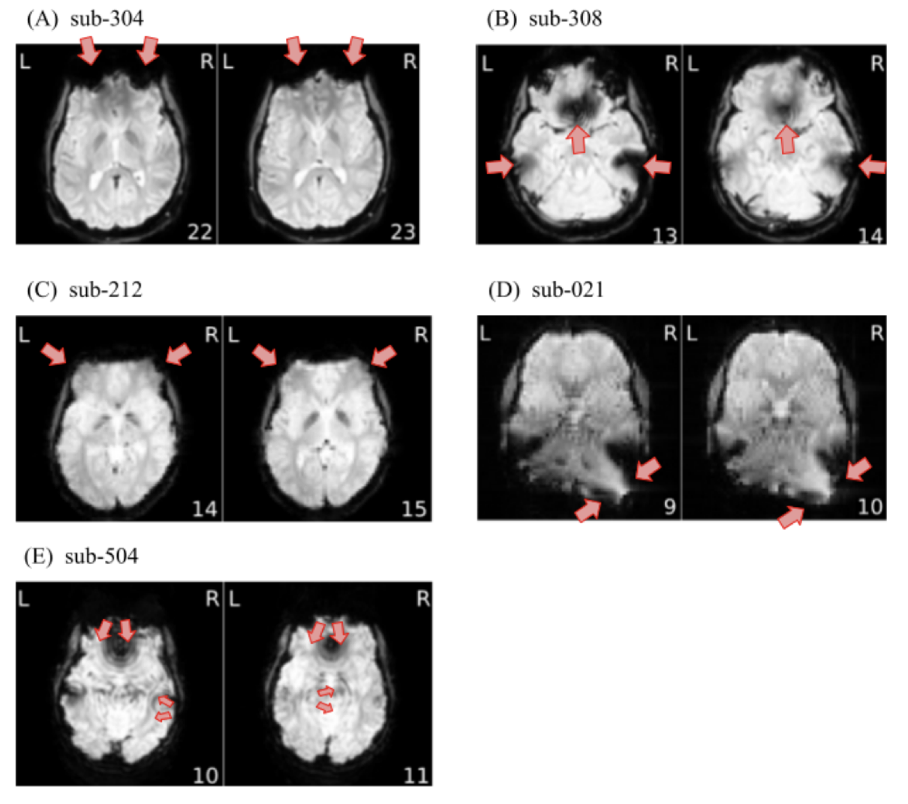

**(Fig. 2)** Signal drop-outs in the anterior PFC (sub-304), vmPFC (sub-308), ear cavities, occipital stretching (sub-021). Sub-504: SDC interacting with head motion creating ripples. (Data Sheet 1, Fig. S2.) [Provins2023]

---

### Check C — Aliasing Ghost

**Where to look:** Background noise panel and SD map. The ghost appears as a shifted, faint repetition of the brain's shape. Compare its brightness to the brain interior in the background noise panel.

**What it indicates:** A ghost is a structured repetition of the brain's signal shifted in the phase-encoding direction, arising from signal instability between EPI k-space pulse cycle repetitions. If the ghost intensity equals the brain's own interior intensity, the measured time series at any overlapping voxel becomes: `Neural signal + Ghost signal`. The ghost signal varies in time independently of local neural activity, creating artificial temporal correlations between anatomically distant brain regions. For resting-state connectivity analysis — designed precisely to detect temporal correlations — this is a fatal contamination. [Provins2023]

> **Key decision:** In the background noise panel, compare ghost brightness to the brain interior. Ghost clearly dimmer → FLAG. Ghost at same brightness as brain → EXCLUDE. (Data Sheet 1, Fig. S3.)

| Finding | Outcome |
|---------|---------|
| No ghost or negligible in background | **PASS** |
| Visible ghost, clearly dimmer than brain interior | **FLAG** |
| Ghost at same intensity as brain interior | **EXCLUDE (Criterion C)** |

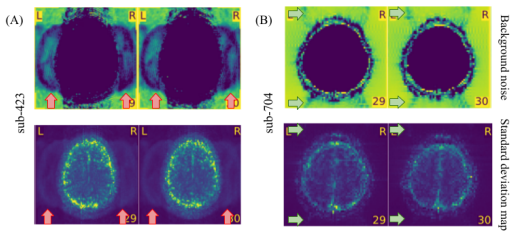
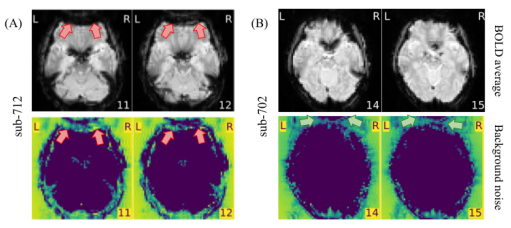

**(Fig. 3)** Sub-423: ghost at brain intensity → exclude (Criterion C). Sub-704: faint ghost → flag but retain. [Provins2023]

---

### Check D — FOV Wrap-Around (BOLD)

**Where to look:** BOLD average panel and background noise panel. Increase screen brightness. The folded region is typically visible at the top or bottom of axial slices as a portion of skull.

**What it indicates:** When the participant's head extends beyond the defined field of view, MRI "wraps" the signal from outside the FOV back onto the opposite edge. The folded structure (usually skull base or vertex) does not contain neural tissue, but its signal varies over time due to respiratory and cardiac pulsation. Where this folded skull signal overlaps the cortex, the measured BOLD time series is a mixture of local neural signal and non-neural pulsatile skull signal, creating spurious correlations and false activations. [Provins2023]

> **Key decision:** Wrap-around that does NOT reach the cortex → FLAG. Wrap-around where the folded skull overlaps or touches the cortex → EXCLUDE. Best assessed in the background noise panel with increased screen brightness. (Data Sheet 1, Fig. S4.)

| Finding | Outcome |
|---------|---------|
| No wrap-around | **PASS** |
| Wrap-around present but not touching brain | **FLAG** |
| Wrap-around overlapping the cortex | **EXCLUDE (Criterion D)** |

---

### Check E — Carpet Plot Crown Region

**Where to look:** The carpet plot in the MRIQC BOLD report. The bottom rows (purple) are the **crown** — voxels on a closed band just outside the brain. Any structured pattern in the crown indicates artifact contamination because no neural signal exists there.

Four patterns to distinguish [Provins2023, Data Sheet 1 Fig. S5]:

| Pattern | Criterion | What it indicates | Outcome |
|---------|-----------|-------------------|---------|
| Crown is flat / featureless | — | No artifact contamination | **PASS** |
| Dark deflections **paired with FD peaks** | EA | Head motion → T2* signal loss and spin-history effects | **FLAG** |
| Periodic undulations **without FD peaks** | EB | Respiratory B₀ modulation aliasing into BOLD band | **FLAG** |
| Abrupt global intensity change **without FD peak** | EC | Hardware coil failure mid-scan — two noise regimes | **EXCLUDE** |
| Strong polarized structure throughout scan | ED | Unknown low-frequency systematic drift | **EXCLUDE** |

**EA — what it means in detail:** During head motion, slices shift in space between excitation and readout, producing sudden signal drops. Residual spin-history effects persist 1–2 TRs after the motion event. Common thresholds: mean FD > 0.5mm [Power2012]; strict studies use mean FD > 0.2mm [Ciric2017]. Scans with >10% of volumes exceeding FD 0.5mm warrant scrutiny. [Lepping2023]

**EB — what it means in detail:** Chest wall motion from breathing creates cyclic B₀ field changes at ~0.3 Hz. At typical TR = 2.5s, this aliases into the low-frequency BOLD band (0.01–0.1 Hz) used in resting-state analysis. Cannot be removed without separately recorded respiratory traces. [Birn2009]

**EC — what it means in detail:** One or more RF receiver coil elements fail during the scan, causing an abrupt global signal drop. The scan is split into two fundamentally different noise regimes and cannot be treated as a single run.

**ED — what it means in detail:** Gradual signal drift of unknown origin produces a temporally smooth but spatially structured low-frequency trend across the brain, indistinguishable from real low-frequency neural signal in resting-state analyses.

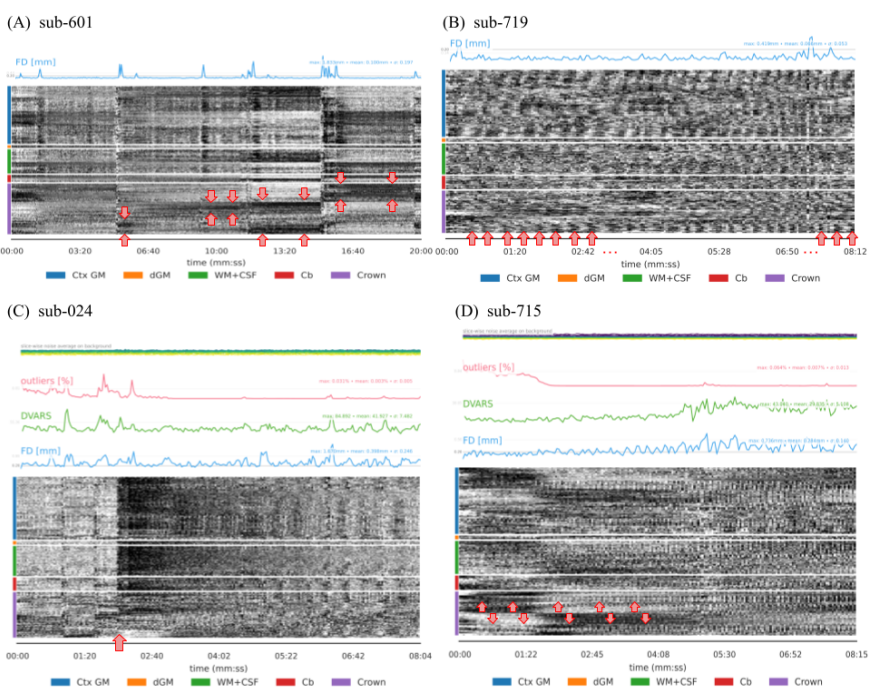

**(Fig. 4)** (A) sub-601: EA — motion peaks in FD trace paired with dark deflections. (B) sub-719: EB — periodic modulation, no FD peaks. (C) sub-024: EC — abrupt intensity change without FD peak → exclude. (D) sub-715: ED — strong polarized structure → exclude. (Data Sheet 1, Fig. S5.) [Provins2023]

---

### Check G — Hyperintensity of Single Slices

**Where to look:** Inspect the outliers and DVARS traces in the carpet plot. If you see sharp spikes limited to single timepoints, scroll through the BOLD average to check for white-pixel individual slices.

**What it indicates:** Motion-related peaks affect multiple or all slices simultaneously. Isolated single-slice hyperintensity — a single axial slice that turns white at one or a few timepoints — indicates a hardware transient: ADC saturation, RF interference spike, or k-space data error affecting only that slice at that TR. This creates an extremely high-amplitude spike in the time series of every voxel in the affected slice. Even a single such spike can severely distort Pearson correlations used in resting-state connectivity analysis. [Provins2023]

| Finding | Outcome |
|---------|---------|
| No single-slice hyperintensity events | **PASS** |
| Isolated single-slice hyperintensity (1–2 events) | **FLAG** |

---

### Check F — ICA Spin-History Artifacts *(only if `--ica` flag was used)*

**Where to look:** ICA component maps in the MRIQC report. Look for components with parallel horizontal stripes spanning the entire brain in one direction.

**What it indicates:** Spin-history effects occur specifically with interleaved slice EPI. When the participant moves between slice acquisitions, the tissue in each slice has an incorrect longitudinal magnetisation history. The RF pulse then tips this incorrectly-prepared magnetisation, producing systematic whole-brain striped patterns in ICA components. Unlike simple motion (which can be censored), spin-history effects create a bias that corrupts every TR in the affected sequence. [Provins2023]

| Finding | Outcome |
|---------|---------|
| No stripe pattern on components | **PASS** |
| Whole-brain parallel stripes on ≥1 component | **FLAG** |

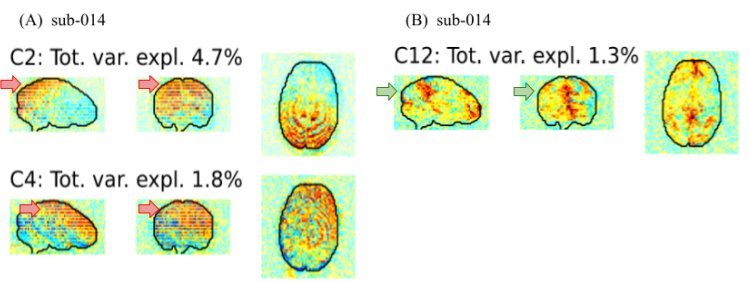

**(Fig. 5)** (A) sub-014 components C2 and C4: parallel stripes → spin-history → FLAG. (B) sub-014 component C12: no stripes → clean. (Data Sheet 1, Fig. S6.) [Provins2023]

---

### Check H — Vertical Strikes in Temporal SD Map

**Where to look:** Sagittal view of the standard deviation (SD/stp) map. Pan through multiple sagittal slices looking for vertical bands of hyperintensity.

**What it indicates:** The temporal SD map shows voxel-wise BOLD variance over the entire scan. Vertical strikes extending hyperintensities **across the entire sagittal plane** indicate that certain k-space lines or slice positions were systematically more variable throughout the scan — possibly RF coil heating, gradient eddy current instability, or systematic k-space spikes. Because it is a systematic effect present in every TR, it cannot be corrected by censoring individual volumes — the affected slices are biased for the entire run. Localised hyperintensities that do not form a full vertical band are acceptable. [Provins2023]

| Finding | Outcome |
|---------|---------|
| No strikes; only localised hyperintensities | **PASS** |
| Clear vertical strikes spanning the whole sagittal plane | **FLAG (Criterion H)** |

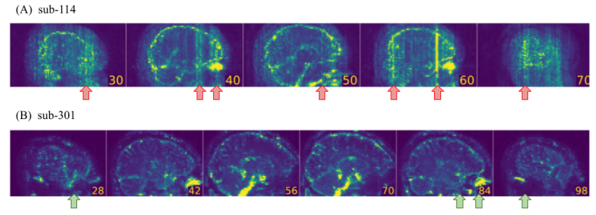

**(Fig. 6)** (A) sub-114: vertical strikes across the whole sagittal plane → FLAG. (B) sub-301: only localised hyperintensities → PASS. (Data Sheet 1, Fig. S8.) [Provins2023]

---

### Check I — Data Formatting Issues

**Where to look:** BOLD average sagittal and axial views. The brain should appear anatomically correct — anterior at top in sagittal, left-right symmetric in coronal. Check that slice numbers match expected anatomical progression.

**What it indicates:** NIfTI header errors cause the image data to be interpreted in the wrong spatial orientation (e.g., anterior–posterior flip, axial slices read as sagittal, left–right swap). Every processing tool reads the header to determine spatial orientation — a wrong header means every step (brain extraction, registration, normalization) operates in the wrong direction. This typically causes complete normalization failure or silent errors where the brain is flipped relative to the template. [Provins2023]

| Finding | Outcome |
|---------|---------|
| Anatomically correct orientation | **PASS** |
| Any axis flip, orientation switch, or missing slices | **EXCLUDE (Criterion I)** |

---

## Stage 2 — MRIQC T1w Report

> Sample report: [MRIQC T1w example](https://mriqc.readthedocs.io/en/latest/reports/smri.html#visual-reports)

---

### Check J — Artifactual Structures in Background (T1w)

**Where to look:** Background regions of the T1w zoomed views and the "Air/No-air segmentation" panels.

**What it indicates:** Same mechanism as BOLD Criterion A. Physical objects in the scanner bore resonate and produce signal in the T1w background. If this signal overlaps brain tissue, automated brain extraction tools (BET, SynthStrip) may include the non-brain object in the brain mask, contaminating all downstream steps including normalization and cortical surface reconstruction. [Provins2023]

| Finding | Outcome |
|---------|---------|
| Clean background | **PASS** |
| Some structures present but clearly outside brain | **FLAG (Criterion J)** |

---

### Check P — Intensity Non-Uniformity

**Where to look:** T1w axial/coronal/sagittal views. Look for a smooth intensity gradient — one hemisphere or pole appearing brighter than the other.

**What it indicates:** Multi-channel RF receive coils amplify signal more in tissue physically close to the coil elements (the brain periphery), producing a smooth spatial gradient. FSL FAST and FreeSurfer's segmentation algorithms assume each tissue type occupies a consistent intensity range across the entire volume. The intensity gradient violates this assumption, causing **tissue misclassification** — inferior WM may be labelled as GM, and peripheral GM as WM. This propagates errors into all parcellation-based ROI analyses, CompCor mask generation, and cortical thickness measurements. The N4 bias field correction applied by fMRIPrep partially compensates for this, but extreme cases may still fail. [Provins2023]

| Finding | Outcome |
|---------|---------|
| Uniform signal or mild gradient | **PASS** |
| Noticeable gradient but tissue still distinguishable | **FLAG** |
| Extreme non-uniformity — tissue types indistinguishable in some regions | **FLAG (Criterion P)** |

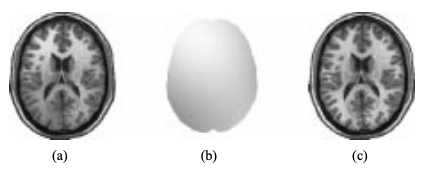
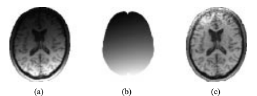

**(Fig. 7)** Non-uniform signal with corresponding spatial signal map showing the gradient. Extreme non-uniformity (Criterion P) appears as a slow, smooth drift in brightness across the image. (Data Sheet 1, Fig. S10F.) [Provins2023]

---

### Check O — Motion-Related and Gibbs Ringing

**Where to look:** T1w axial and sagittal views. Look for concentric ripples or "echo" lines emanating from tissue–CSF boundaries, particularly around the corpus callosum, cortical sulci, and brain stem.

**What it indicates:** The T1w acquisition takes several minutes. If the participant moves during this time, different portions of k-space are acquired with slightly different head positions, creating characteristic concentric ringing patterns (Gibbs ringing). Unlike BOLD where individual volumes can be censored, **the T1w is a single static image** — motion corrupts the entire volume with no censoring option. Severe Gibbs ringing: (1) creates false tissue boundaries that confuse FSL FAST and FreeSurfer tissue classification; (2) degrades cortical surface reconstruction, introducing artificial bumps in the pial surface. [Provins2023]

| Finding | Outcome |
|---------|---------|
| No ringing visible | **PASS** |
| Mild ringing confined to brain–CSF boundaries | **FLAG** |
| Severe ringing throughout, tissue boundaries ambiguous | **FLAG (Criterion O)** |

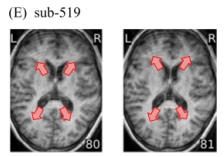

**(Fig. 8)** Concentric ripples caused by head motion — Gibbs ringing (Criterion O). (Data Sheet 1, Fig. S10E.) [Provins2023]

---

### Check L — Aliasing Ghost (T1w)

**Where to look:** T1w axial views and background areas. Look for a faint shifted copy of the brain.

**What it indicates:** A T1w aliasing ghost appears as a faint shifted copy of the brain in the phase-encoding direction. In T1w images the background suppression is generally better than EPI, so the ghost may be subtle. However, if the ghost signal overlaps brain tissue, automated brain extraction tools may include parts of the ghost in the brain mask, creating an incorrectly large mask that incorporates non-brain signal. This propagates into normalization and segmentation. [Provins2023]

| Finding | Outcome |
|---------|---------|
| No ghost or very faint | **PASS** |
| Visible shifted copy of brain in background | **FLAG (Criterion L)** |

---

### Check M — FOV Wrap-Around (T1w)

**Where to look:** T1w axial views. Look for skull material folded onto the contralateral temporal lobe or vertex.

**What it indicates:** Same mechanism as BOLD Criterion D, but with more severe downstream consequences. A folded skull overlapping the brain creates a region of abnormally high signal that automated segmentation tools interpret as brain tissue. FreeSurfer may attempt to reconstruct a cortical surface through the folded skull material, and FSL FAST may classify it as WM. This directly corrupts brain mask generation, tissue segmentation, and surface reconstruction — all fMRIPrep processing steps that depend on the T1w anatomy will be compromised. [Provins2023]

| Finding | Outcome |
|---------|---------|
| No wrap-around | **PASS** |
| Wrap-around not touching brain | **FLAG** |
| Wrap-around overlapping the brain | **EXCLUDE (Criterion M)** |

---

### Check Q — Eye Spillover

**Where to look:** T1w axial slices at the level of the orbits. Look for bright signal leaking posteriorly from the eyes into the anterior frontal lobe along the anterior–posterior phase-encoding direction.

**What it indicates:** Orbital fat has very high T1w signal intensity. When the participant blinks or makes small eye movements during the T1w acquisition, this bright signal leaks into the brain along the phase-encoding direction. The OFC, anterior temporal pole, and amygdala are most commonly affected. Automated tissue segmentation tools interpret the spurious bright signal as WM, creating misclassified voxels in regions that should be cortical GM. This directly impairs any analysis targeting the OFC, amygdala, or anterior temporal lobe, and compromises the CompCor WM mask if those voxels are included. [Provins2023]

| Finding | Outcome |
|---------|---------|
| No eye signal in brain tissue | **PASS** |
| Minimal leakage, not reaching frontal GM | **FLAG** |
| Significant overlap with OFC / frontal / temporal lobe | **FLAG (Criterion Q)** |

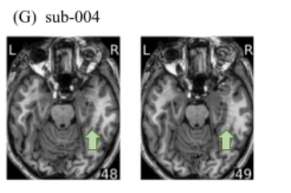

**(Fig. 9)** Eye spillover — signal leakage across the brain in the anterior-posterior phase-encoding direction (Criterion Q). (Data Sheet 1, Fig. S10G.) [Provins2023]

---

## Stage 3 — fMRIPrep Report

> Sample report: [fMRIPrep sample report](https://fmriprep.org/en/stable/_static/SampleReport/sample_report.html)

---

### Check S — Brain Mask Accuracy

**Where to look:** Brain mask panel in the fMRIPrep report. A coloured outline is overlaid on the T1w and should closely follow the inner surface of the skull without excluding cortical tissue or including non-brain tissue.

**What it indicates:** The brain mask is the foundational structure from which every subsequent step is derived — tissue segmentation, normalization, CompCor mask generation, and the voxels that enter group analysis. Holes within the mask (from signal dropout) mean those brain regions are **absent from all group analyses**. Cortical regions missing from the mask cannot be restored after this step. Spurious inclusions (skull, dura) add high-amplitude non-neural signal that inflates noise in all multivariate analyses and confuses tissue segmentation. [Provins2023]

| Finding | Outcome |
|---------|---------|
| Accurate and complete, closely following skull | **PASS** |
| Minor imperfections at periphery, no cortical regions missing | **FLAG** |
| Major cortical regions missing, large holes, or significant non-brain inclusions | **EXCLUDE (Criterion S)** |

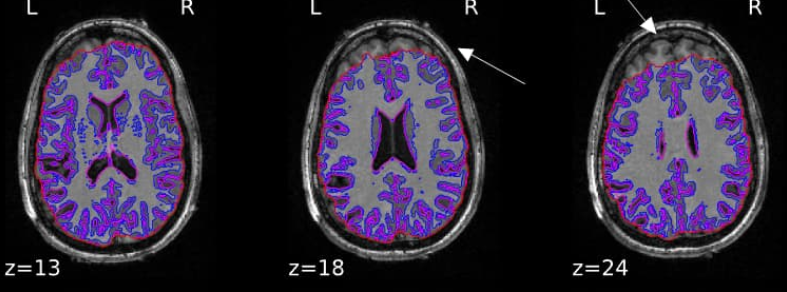

**(Fig. 10)** Inaccurate brain mask — large cortical regions excluded from lateral surface (Criterion S → exclude). [Provins2023]

---

### Check R — MNI Normalization

**Where to look:** "Normalization" section of the fMRIPrep report — the animated overlay alternating between the participant's normalised T1w and the MNI152 template. Watch internal structures for alignment.

**What it indicates:** Spatial normalisation maps each participant's anatomy to MNI152 standard space so that voxel coordinates correspond to the same anatomical structure across participants. This is the prerequisite for **every group-level analysis**. If normalisation fails, the group average at any given MNI coordinate averages signal from anatomically different locations across participants — group t-maps reflect meaningless spatial patterns. Check in order of importance: (1) ventricles, (2) subcortical nuclei, (3) corpus callosum, (4) cerebellum, (5) cortical GM. Mismatch at the ventricle level is the clearest sign of failure. [Provins2023, Lepping2023]

| Finding | Outcome |
|---------|---------|
| Good alignment of all structures | **PASS** |
| Minor misalignment at cortical surface only, internal structures aligned | **FLAG** |
| Ventricles or subcortical structures clearly misaligned | **EXCLUDE (Criterion R)** |

---

### Check W — EPI–T1w Coregistration

**Where to look:** "Coregistration" section of the fMRIPrep report — the animated overlay between the normalised T1w and the mean BOLD image.

**What it indicates:** Coregistration brings the BOLD image into the same anatomical space as the T1w so that each BOLD voxel can be assigned to an anatomical label. Poor coregistration means the BOLD signal at a given voxel is incorrectly attributed to an anatomical region — the signal you analyse as "amygdala" may originate from the hippocampus or surrounding cortex. **Every ROI analysis is anatomically wrong** if coregistration fails. Connectivity between regions is also biased because signal from one region contaminates the labelled voxels of another. [Provins2023]

| Finding | Outcome |
|---------|---------|
| Good alignment — sulci/gyri and internal structures match | **PASS** |
| Minor misalignment at periphery only | **FLAG** |
| Clear misalignment — brain outlines or internal structures do not match | **EXCLUDE (Criterion W)** |

---

### Check T — Residual Susceptibility Distortion

**Where to look:** fMRIPrep "susceptibility distortion correction" panel — animated overlay of pre-correction and post-correction BOLD images, and overlay with T1w.

**What it indicates:** Even after applying SDC correction using field maps, some residual distortion may persist in the most susceptibility-affected regions (OFC, vmPFC, inferior temporal lobe above the petrous bone). This means BOLD signal in these regions is still spatially displaced relative to the T1w anatomy. The degree of residual distortion depends on how well the field map represents the actual B₀ distribution during BOLD acquisition — they may differ if the participant moved substantially between field map and BOLD acquisitions. Studies targeting the OFC, amygdala, or inferior temporal regions should treat significant residual distortion as a hard exclusion criterion. [Provins2023]

| Finding | Outcome |
|---------|---------|
| No visible residual distortion | **PASS** |
| Mild residual in regions not critical for your study | **FLAG** |
| Severe residual in study-critical regions (OFC, amygdala, temporal) | **FLAG — consider EXCLUDE (Criterion T)** |

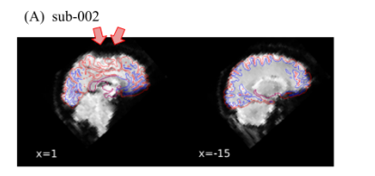

**(Fig. 11)** sub-002: Residual signal drop-out persisting after preprocessing (arrows) — led to exclusion of the scan. (Data Sheet 1, Fig. S11.) [Provins2023]

---

### Check U — Brain Tissue Segmentation

**Where to look:** Brain segmentation panel. **Pink contour** = ventricle boundary. **Blue contour** = WM–GM boundary.

**What it indicates:** Tissue segmentation classifies every voxel as WM, GM, or CSF. This classification is used by fMRIPrep to construct the CompCor masks and any parcellation applied to the data. Low SNR in the T1w causes the classifier to confuse tissue types at boundaries.

Two patterns to distinguish:
1. **Scattered misclassified voxels inside the ventricles** — T1w SNR was too low for reliable classification. These misclassified voxels will contaminate the CompCor WM/CSF masks with neural signal from nearby grey matter. → **FLAG (Criterion U)**
2. **Spots at the WM–GM boundary** — a known, expected artefact of fMRIPrep's surface-based segmentation (partial volume effects). Does **not** indicate a quality problem. → **PASS**

[Provins2023, Data Sheet 1 Fig. S12]

| Finding | Outcome |
|---------|---------|
| Clean contours; boundary dots at WM–GM interface are acceptable | **PASS** |
| Scattered misclassified voxels inside WM or ventricles | **FLAG (Criterion U)** |

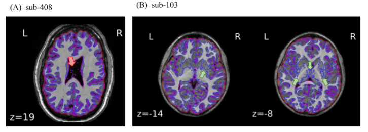

**(Fig. 12)** (A) sub-408: single voxels inside ventricles misclassified → FLAG. (B) sub-103: boundary spots from partial volume effect — acceptable, PASS. (Data Sheet 1, Fig. S12.) [Provins2023]

---

### Check X — CompCor Region Quality

**Where to look:** CompCor mask panels in the fMRIPrep report. The tCompCor mask (most variable voxels) and aCompCor mask (anatomical WM/CSF) should be overlaid on the BOLD-space T1w and should cover only WM and CSF.

**What it indicates:** fMRIPrep's nuisance regression extracts principal components from WM and CSF timeseries and regresses them from the BOLD data as noise. If the tCompCor mask instead delineates a straight line spanning the whole brain (Data Sheet 1, Fig. S13), or covers visible cortical GM, then the principal components extracted from it **contain real neural BOLD variance**. Regressing these "noise" components removes the very signal you are studying — the opposite of denoising. This error is undetectable from the cleaned data alone; it must be caught during QC. [Provins2023]

| Finding | Outcome |
|---------|---------|
| Masks confined to WM/CSF — anatomically sensible | **PASS** |
| Minor intrusion into GM boundaries | **FLAG** |
| Straight-line mask spanning whole brain, or clear coverage of functional cortex | **FLAG — consider EXCLUDE (Criterion X)** |

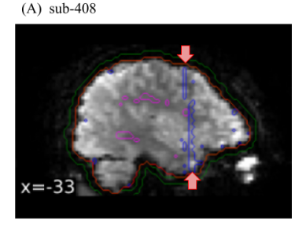

**(Fig. 13)** sub-408: tCompCor mask (blue line) forms a straight line across the whole brain — scan excluded. (Data Sheet 1, Fig. S13.) [Provins2023]

---

## Summary Reference Card

### MRIQC BOLD Criteria [Provins2023]

| Code | Name | Hard Exclude? |
|------|------|:---:|
| A | Background artifacts spilling onto brain | ✅ |
| BA | BOLD signal drop-out | ✅ |
| BB | Brain distortions from SDC | ✅ if severe |
| C | Aliasing ghost (brain intensity) | ✅ |
| D | FOV wrap-around overlapping cortex | ✅ |
| EA | Crown structure — motion peaks | FLAG |
| EB | Crown structure — respiration | FLAG |
| EC | Coil failure in carpet plot | ✅ |
| ED | Drift of unknown source | ✅ |
| F | ICA spin-history stripes | FLAG |
| G | Hyperintensity of single slices | FLAG |
| H | Vertical strikes in sagittal SD map | FLAG |
| I | Data formatting issues | ✅ |

### MRIQC T1w Criteria [Provins2023]

| Code | Name | Hard Exclude? |
|------|------|:---:|
| J | Background artifacts T1w | FLAG |
| KA | Signal drop-out T1w | ✅ if severe |
| L | Aliasing ghost T1w | FLAG |
| M | FOV wrap-around overlapping brain | ✅ |
| N | Data formatting issues | ✅ |
| O | Motion / Gibbs ringing | FLAG |
| P | Extreme intensity non-uniformity | FLAG |
| Q | Eye spillover | FLAG |

### fMRIPrep Criteria [Provins2023]

| Code | Name | Hard Exclude? |
|------|------|:---:|
| R | Failure in MNI normalization | ✅ |
| S | Inaccurate brain mask | ✅ if major |
| T | Residual susceptibility distortion | Conditional |
| U | Brain tissue segmentation error | FLAG |
| V | Surface reconstruction problem | FLAG |
| W | Co-registration problem | ✅ |
| X | CompCor regions cover neural sources | Conditional |

---

## Post-Processing Sanity Checks *(Optional but Recommended)*

After denoising, perform these additional checks to validate data quality [Teves2023]:

1. **Resting-state networks** — Plot known networks (DMN, Visual, Auditory). If expected networks are absent, topographically wrong, or the DMN appears inverted/shifted, re-examine motion denoising and check for residual motion artefacts.

   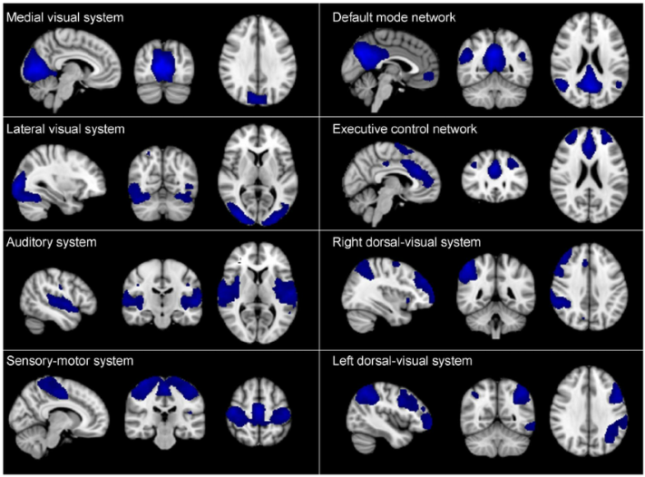
   *(Fig. 14) Expected resting-state networks. Use as a reference to validate your data post-denoising.*

2. **Ventricle–GM correlation** — Correlate the mean ventricle time series with the whole brain. **No significant correlation in GM is expected.** Positive correlations in GM indicate incomplete denoising or a compromised CompCor mask (re-check Criterion X).

   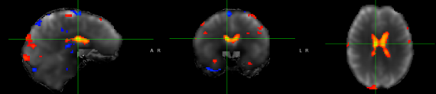
   *(Fig. 15) No significant correlation in GM is expected.*

3. **t-SNR maps** — Temporal SNR = detrended mean / temporal standard deviation. Do **not** smooth before computing t-SNR. For 3T, physiological-noise-limited reference values: GM ~78–90, WM ~110–160. Compare tSNR across subjects — outlier-low values warrant re-inspection of the raw data. [Teves2023, Kruger & Glover 2001]

   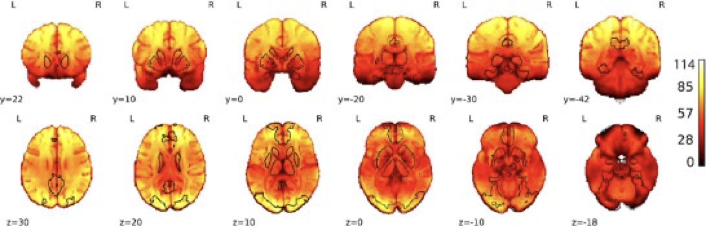
   *(Fig. 16) t-SNR map example — this is 7T data; values will be lower at 3T.*

4. **Task activations** (if task data) — Verify activations appear in anatomically expected locations. Activations primarily outside the brain indicate coregistration or normalization failure. [Teves2023]

---

## References

1. Provins C, MacNicol E, Seeley SH, Hagmann P, Esteban O. (2023). Quality control in functional MRI studies with MRIQC and fMRIPrep. *Frontiers in Neuroimaging* 1:1073734. https://doi.org/10.3389/fnimg.2022.1073734

2. Lepping RJ et al. (2023). Quality control in resting-state fMRI: the benefits of visual inspection. *Frontiers in Neuroscience* 17:1076824. https://doi.org/10.3389/fnins.2023.1076824

3. Teves JB et al. (2023). The art and science of using quality control to understand and improve fMRI data. *Frontiers in Neuroscience* 17:1100544. https://doi.org/10.3389/fnins.2023.1100544

4. Power JD, Barnes KA, Snyder AZ, Schlaggar BL, Petersen SE. (2012). Spurious but systematic correlations in functional connectivity MRI networks arise from subject motion. *NeuroImage* 59:2142–2154. https://doi.org/10.1016/j.neuroimage.2011.10.018

5. Ciric R et al. (2017). Benchmarking of participant-level confound regression strategies for the control of motion artifact in studies of functional connectivity. *NeuroImage* 154:174–187. https://doi.org/10.1016/j.neuroimage.2017.03.020

6. Birn RM et al. (2009). The effect of respiration variations on independent components and resting-state functional connectivity. *NeuroImage* 47:1486–1498. https://doi.org/10.1016/j.neuroimage.2009.05.048

7. Esteban O et al. (2017). MRIQC: Advancing the automatic prediction of image quality in MRI from unseen sites. *PLOS ONE* 12(9):e0184661. https://doi.org/10.1371/journal.pone.0184661

8. Esteban O et al. (2019). fMRIPrep: a robust preprocessing pipeline for functional MRI. *Nature Methods* 16:111–116. https://doi.org/10.1038/s41592-018-0235-4

9. Power JD. (2017). A simple but useful way to assess fMRI scan qualities. *NeuroImage* 154:150–158. https://doi.org/10.1016/j.neuroimage.2016.08.009

10. Kruger G, Glover GH. (2001). Physiological noise in oxygenation-sensitive magnetic resonance imaging. *Magnetic Resonance in Medicine* 46:631–637.

11. Hutton C et al. (2002). Image distortion correction in fMRI: A quantitative evaluation. *NeuroImage* 16:217–240.

12. MRIQC Documentation — Image Quality Metrics. https://mriqc.readthedocs.io/en/stable/iqms/bold.html
